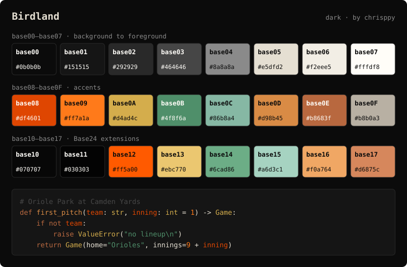

# base24-themes

[Base24](https://github.com/tinted-theming/base24) color schemes for Nix, with a
small library of format converters and a module for NixOS and Home Manager.

## Birdland



A dark theme in Baltimore Orioles colors: black and gray from the 2023 City
Connect uniforms, cream, Camden Yards green and warehouse-brick orange from the
2026 City Connect uniforms, and the official Orioles orange (`#df4601`). Every
accent reaches at least 4.5:1 contrast on the background.

| Slot | Color | Hex | Used for |
| -------- | ---------------------------- | -------- | ---------------------------- |
| `base00` | Black | `0b0b0b` | Background |
| `base01` | Black | `151515` | Panels, secondary background |
| `base02` | Dark gray | `292929` | Selection |
| `base03` | Gray | `464646` | Comments, inactive elements |
| `base04` | Gray | `8a8a8a` | Muted foreground |
| `base05` | Cream | `e5dfd2` | Foreground |
| `base06` | Warm white | `f2eee5` | Bright foreground |
| `base07` | White | `fffdf8` | Maximum contrast |
| `base08` | Orioles orange | `df4601` | Variables, errors |
| `base09` | Bright orange | `ff7a1a` | Numbers, constants |
| `base0A` | Brass (Eutaw Street plaques) | `d4ad4c` | Classes, warnings |
| `base0B` | Camden Yards seat green | `4f8f6a` | Strings, success |
| `base0C` | Pale Camden green | `86b8a4` | Support, escapes |
| `base0D` | Warehouse orange | `d98b45` | Functions, links |
| `base0E` | Baltimore brick | `b8683f` | Keywords |
| `base0F` | Warm gray | `b8b0a3` | Deprecated, embedded |
| `base10` | Black | `070707` | Darker background |
| `base11` | Black | `030303` | Darkest background |
| `base12` | Bright Orioles orange | `ff5a00` | Bright red |
| `base13` | Bright brass | `ebc770` | Bright yellow |
| `base14` | Bright Camden green | `6cad86` | Bright green |
| `base15` | Bright pale green | `a6d3c1` | Bright cyan |
| `base16` | Bright warehouse orange | `f0a764` | Bright blue |
| `base17` | Bright brick | `d6875c` | Bright magenta |

The blue and magenta slots are deliberately orange and brick to stay within the
Orioles colors.

## Features

- **Bundled theme**: ships with `birdland` (dark), with more planned. Every file
  in `themes/` is picked up automatically.
- **Format converters**: `toYaml` (tinted-theming scheme format), `toJson`,
  `toScss`, `toQml` and `toSvg` (the preview image above).
- **Validation**: themes are checked for missing or malformed colors, and
  `nix flake check` verifies every bundled theme.
- **Module**: one module for NixOS and Home Manager that exposes the selected
  theme as `config.lib.base24`.

## Installation

Add `base24-themes` as an input in your `flake.nix`:

```nix
{
  inputs = {
    nixpkgs.url = "github:NixOS/nixpkgs/nixos-unstable";
    base24-themes.url = "github:chrisppy/base24-themes";
    base24-themes.inputs.nixpkgs.follows = "nixpkgs";
  };

  outputs = { self, nixpkgs, base24-themes, ... }: {
    # Your flake outputs...
  };
}
```

## Library

Everything lives at `lib.base24`: the functions, the bundled themes
(`lib.base24.themes.<name>`) and their preview images
(`lib.base24.previews.<name>`). It is system-independent.

```nix
let
  base24 = inputs.base24-themes.lib.base24;
  theme = base24.themes.birdland;
in
{
  qml = base24.toQml theme;   # QML singleton
  yaml = base24.toYaml theme; # tinted-theming scheme
  json = base24.toJson theme;
  scss = base24.toScss theme;
  bg = base24.getColorHex theme "base00"; # "#0b0b0b"
}
```

| Function | Returns |
| ------------------------------------------------ | ------------------------------------------------------------------------------ |
| `normalizeTheme theme` | The theme with all 24 colors filled in and lowercased; throws on invalid input |
| `getColors theme` | An attrset of just the 24 colors |
| `getColor theme name` / `getColorHex theme name` | One color, without or with a leading `#` |
| `toYaml`, `toJson`, `toScss`, `toQml` | The theme as a string in that format |
| `toSvg theme` | A preview image: palette swatches plus a highlighted code sample |

`toQml` produces a `pragma Singleton` file. Register it in a `qmldir` next to
it, for example `singleton Theme 1.0 Theme.qml`.

The library needs only a nixpkgs `lib`, so it also works without flakes:

```nix
base24 = import "${base24-themes-source}/lib" { inherit (pkgs) lib; };
```

## Defining your own theme

A theme is a flat attrset of `base00`–`base17`, plus optional `name`, `author`
and `variant` (`"dark"` or `"light"`, default `"dark"`). Colors are six hex
digits **without** a leading `#`.

```nix
{
  name = "My Theme";
  author = "me";
  variant = "dark";
  base00 = "181818"; # background
  base01 = "282828";
  base02 = "383838";
  base03 = "585858";
  base04 = "b8b8b8";
  base05 = "d8d8d8"; # foreground
  base06 = "e8e8e8";
  base07 = "f8f8f8";
  base08 = "ab4642"; # red
  base09 = "dc9656"; # orange
  base0A = "f7ca88"; # yellow
  base0B = "a1b56c"; # green
  base0C = "86c1b9"; # cyan
  base0D = "7cafc2"; # blue
  base0E = "ba8baf"; # magenta
  base0F = "a16946"; # brown
  # Base24 extensions
  base10 = "101010"; # darker background (not lighter than base00)
  base11 = "0c0c0c"; # darkest background (not lighter than base10)
  base12 = "d0605c"; # bright red
  base13 = "fbd9a6"; # bright yellow
  base14 = "bbcf88"; # bright green
  base15 = "a3d5cd"; # bright cyan
  base16 = "9cc8da"; # bright blue
  base17 = "d3a9ca"; # bright magenta
}
```

Base16 themes (only `base00`–`base0F`) are accepted too. The missing colors fall
back to `base00` for `base10`/`base11` and to the matching normal color for
`base12`–`base17`.

To bundle a theme, add it as `themes/<name>.nix`. Its key is the file name, and
`name` defaults to it. Bundled themes must define all 24 colors and need a
preview image:

```sh
nix eval --raw .#lib.base24.previews.<name> > previews/<name>.svg
```

`nix flake check` fails if a preview is missing or out of date.

## NixOS and Home Manager module

The same module is exported as `nixosModules.default` and
`homeManagerModules.default`:

```nix
{ inputs, config, ... }: {
  imports = [ inputs.base24-themes.homeManagerModules.default ];

  base24.theme = "birdland";
  # or: base24.customTheme = { base00 = "181818"; ... };

  # Use the colors anywhere in your configuration:
  # config.lib.base24.colors.base05     -> "d8d8d8"
  # config.lib.base24.getColorHex "base0D"
  # config.lib.base24.qml               -> QML singleton source
}
```

| Option | Default | Description |
| -------------------- | ------------ | --------------------------------------- |
| `base24.enable` | `true` | Expose the theme as `config.lib.base24` |
| `base24.theme` | `"birdland"` | A bundled theme name |
| `base24.customTheme` | `null` | An inline theme; overrides `theme` |

The module only exposes colors. It does not configure any applications itself.

## Development

```sh
nix flake check   # run the tests (also run in CI on every push and pull request)
nix fmt           # format
```

```
lib/
  default.nix        library entry point (`lib.base24`)
  core.nix           validation, fallbacks, color access
  themes.nix         loads themes/
  formats/           one file per exporter: yaml, json, scss, qml, svg
nix/                 flake-parts glue, loaded automatically
  lib.nix            exports lib.base24
  module.nix         NixOS / Home Manager module
  checks.nix         turns tests/ into `nix flake check`
tests/               one suite per area, plus shared fixtures
themes/              one file per theme
previews/            generated SVG previews used in this README
```

To add a format, create `lib/formats/<name>.nix` (it receives `{ lib, core }`
and returns a `theme -> string` function), register it in `lib/default.nix` and
add a test to `tests/formats.nix`.

## License

MIT. See [LICENSE](./LICENSE).
