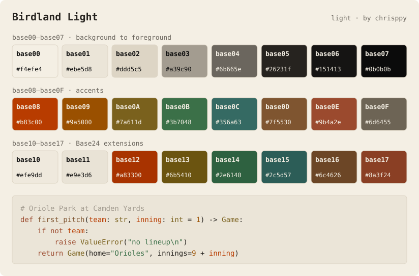

## Birdland Light

The light counterpart of [Birdland](./birdland.md). The cream of the 2026 City
Connect uniforms becomes the background and black the text, and the Orioles
orange, brass, Camden Yards green and warehouse-brick accents are deepened so
every accent reaches at least 4.5:1 contrast on both the background and the
panels.

| Slot | Color | Hex | Used for |
| -------- | ---------------------------- | -------- | ---------------------------- |
| `base00` | Cream | `f4efe4` | Background |
| `base01` | Darker cream | `ebe5d8` | Panels, secondary background |
| `base02` | Tan | `ddd5c5` | Selection |
| `base03` | Warm gray | `a39c90` | Comments, inactive elements |
| `base04` | Dark warm gray | `6b665e` | Muted foreground |
| `base05` | Charcoal | `26231f` | Foreground |
| `base06` | Near black | `151413` | Bright foreground |
| `base07` | Black | `0b0b0b` | Maximum contrast |
| `base08` | Deep Orioles orange | `b83c00` | Variables, errors |
| `base09` | Amber orange | `9a5000` | Numbers, constants |
| `base0A` | Brass (Eutaw Street plaques) | `7a611d` | Classes, warnings |
| `base0B` | Camden Yards seat green | `3b7048` | Strings, success |
| `base0C` | Deep pale Camden green | `356a63` | Support, escapes |
| `base0D` | Warehouse brown | `7f5530` | Functions, links |
| `base0E` | Baltimore brick | `9b4a2e` | Keywords |
| `base0F` | Warm gray | `6d6455` | Deprecated, embedded |
| `base10` | Darker cream | `efe9dd` | Darker background |
| `base11` | Darkest cream | `e9e3d6` | Darkest background |
| `base12` | Intense Orioles orange | `a83300` | Bright red |
| `base13` | Intense brass | `6b5410` | Bright yellow |
| `base14` | Intense Camden green | `2e6140` | Bright green |
| `base15` | Intense pale green | `2c5d57` | Bright cyan |
| `base16` | Intense warehouse brown | `6c4626` | Bright blue |
| `base17` | Intense brick | `8a3f24` | Bright magenta |

The official Orioles orange (`#df4601`) reaches only 3.6:1 on cream, so `base08`
uses a deeper shade of it. As in Birdland, the blue and magenta slots are brown
and brick to stay within the Orioles colors, and the "bright" slots are more
intense rather than lighter, so they stay readable on a light background.
