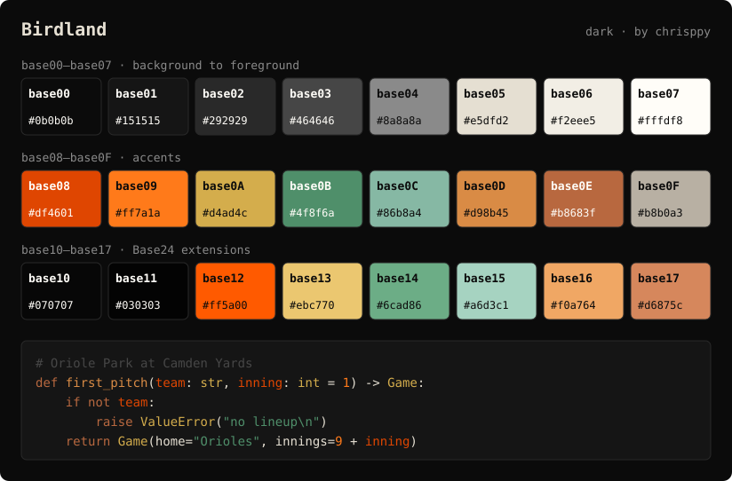

## Birdland

A dark theme in Baltimore Orioles colors: black and gray from the 2023 City
Connect uniforms, cream, Camden Yards green and warehouse-brick orange from the
2026 City Connect uniforms, and the official Orioles orange (`#df4601`). Every
accent reaches at least 4.5:1 contrast on the background.

| Slot | Color | Hex | Used for |
| -------- | ---------------------------- | -------- | ---------------------------- |
| `base00` | Black | `0b0b0b` | Background |
| `base01` | Black | `151515` | Panels, secondary background |
| `base02` | Dark gray | `292929` | Selection |
| `base03` | Gray | `464646` | Comments, inactive elements |
| `base04` | Gray | `8a8a8a` | Muted foreground |
| `base05` | Cream | `e5dfd2` | Foreground |
| `base06` | Warm white | `f2eee5` | Bright foreground |
| `base07` | White | `fffdf8` | Maximum contrast |
| `base08` | Orioles orange | `df4601` | Variables, errors |
| `base09` | Bright orange | `ff7a1a` | Numbers, constants |
| `base0A` | Brass (Eutaw Street plaques) | `d4ad4c` | Classes, warnings |
| `base0B` | Camden Yards seat green | `4f8f6a` | Strings, success |
| `base0C` | Pale Camden green | `86b8a4` | Support, escapes |
| `base0D` | Warehouse orange | `d98b45` | Functions, links |
| `base0E` | Baltimore brick | `b8683f` | Keywords |
| `base0F` | Warm gray | `b8b0a3` | Deprecated, embedded |
| `base10` | Black | `070707` | Darker background |
| `base11` | Black | `030303` | Darkest background |
| `base12` | Bright Orioles orange | `ff5a00` | Bright red |
| `base13` | Bright brass | `ebc770` | Bright yellow |
| `base14` | Bright Camden green | `6cad86` | Bright green |
| `base15` | Bright pale green | `a6d3c1` | Bright cyan |
| `base16` | Bright warehouse orange | `f0a764` | Bright blue |
| `base17` | Bright brick | `d6875c` | Bright magenta |

The blue and magenta slots are deliberately orange and brick to stay within the
Orioles colors. For a light variant, see [Birdland Light](./birdland-light.md).
